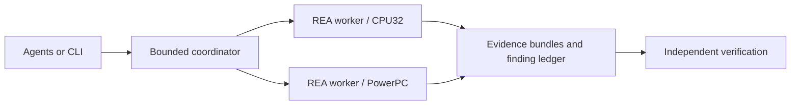

# PCM investigations with REA

This initiative builds an open engine-management platform for GM controller hardware, with separate Gen III and Gen IV firmware targets. The current implementation establishes parallel, evidence-backed firmware investigation. The earlier LS PCM implementation is supplementary research.

The REA fork adds explicit raw CPU32 and big-endian PowerPC profiles, plus independent image load addresses and execution entries. The coordinator runs isolated REA/Ghidra worker processes, serializes each Program's requests, exports evidence before closing, and preserves per-job failures and unresolved questions.

See [the verification receipt](VERIFICATION.md) for the executed checks and current limits.



## Environment

Development and verification use WSL, Node 24.22.1, npm 11.16.0, Python 3.12, Java 21, and Ghidra 12.1.4. Ghidra and Java remain caller-provided. GNU `m68k-linux-gnu` and `powerpc-linux-gnu` binutils build the source-owned fixtures; no firmware is executed.

Install REA's locked dependencies with `npm ci`, then run `npm run build:cached` from the checkout. Create a Python virtual environment and install `requirements-coordinator.txt`. The local setup uses `/opt/pcm-reversal` for tool installations, images, generated fixtures, and ephemeral analysis resources.

## Run an investigation

From this directory, with the analysis virtual environment active:

```bash
python verification/prepare_fixtures.py --output /opt/pcm-reversal/verification-fixtures
python verification/create_investigation.py --analysis-root /opt/pcm-reversal --rea-root /opt/pcm-reversal/tools/rea --output .analysis/parallel-investigation.json
python -m coordinator .analysis/parallel-investigation.json --output .analysis/investigations
```

The plan generator accepts explicit REA, Node, and Ghidra locations. Profiles pin the expected research-image SHA-256 and source URL. Acquire those images locally; firmware binaries and Ghidra projects are excluded from the repository.

The seven-job verification plan covers P59 OS 12587603, E38 OS 12607218, CPU32 table interpolation, PowerPC calls, relocated mappings, and legacy omitted-load behavior. Use `verification/run_investigation.py` to measure a run and `verification/check_evidence.py` to check one job's exported bundle against its source bytes.

## Agent access

```bash
python -m coordinator.mcp_server --max-workers 2
```

The stdio MCP adapter exposes submit, status, cancel, job-summary, call, and evidence operations. Submit returns immediately. A server-wide semaphore bounds active REA worker processes across submitted runs. Job summaries are compact; retrieve a selected call or exact Evidence ID for the full result.

Each run retains an explicit plan, event timeline, per-call replies, evidence bundles, job reports, and finding/unknown ledgers. Completed jobs mean the requested static observations were collected. An analyst or independent verifier must cite evidence before marking a research question answered.

## Verification limits

Load-image verification establishes byte identity, mapping, selected language, and entry coordinates. It does not prove complete instruction semantics, function discovery, peripheral behavior, or runtime equivalence. P59 startup control-flow warnings and PowerPC core-specific limitations remain visible. RAM, peripheral maps, and actual hardware execution are further work.

Run coordinator tests with `python -m unittest discover -s coordinator/tests -v`. REA's focused source and boundary tests are documented in the fork's `docs/testing.md`.
